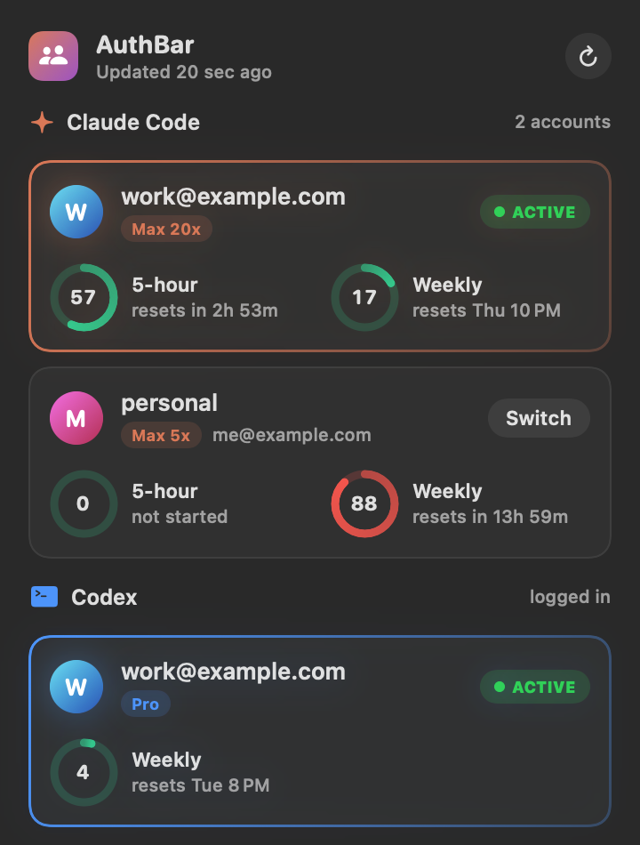

# AuthBar

A macOS menu bar app for switching between Claude Code accounts and watching your
Claude Code and Codex usage limits.



- **One-click account switching** for Claude Code. Click an account and new
  `claude` sessions use it.
- **Live usage** for each account: the 5-hour and weekly limits as rings, with
  time until reset. Refreshes every 2 minutes and whenever you open the panel.
- **Menu bar gauge**: the active Claude account's 5-hour usage (outer ring),
  weekly usage (inner ring) and 5-hour percentage.
- **Codex usage** for the account logged in to the Codex CLI.
- **No extra logins**: it reuses the logins Claude Code and Codex already saved.
- A single Swift file and no dependencies.

## Install

Requires macOS 14 or later and the Xcode Command Line Tools
(`xcode-select --install`).

```sh
git clone https://github.com/shrimalmadhur/authbar.git
cd authbar
./build.sh
open build/AuthBar.app
```

To start it at login, add `build/AuthBar.app` under System Settings → General →
Login Items.

## Usage

1. Log in to Claude Code with your first account (`claude`, then `/login`).
2. Open AuthBar and click **Save current login**.
3. Log in to Claude Code with your next account and save it the same way.
4. Click any account to switch to it.

Claude Code sessions that are already running keep their account; start a new
session to use the one you switched to.

## How it works

### Claude Code

Claude Code keeps its login in the macOS Keychain (service
`Claude Code-credentials`). AuthBar saves a copy of each account's login in the
Keychain under the service `cc-auth`, and switching writes the chosen copy back.

- Only the `claudeAiOauth` login is swapped. MCP server tokens stored in the same
  Keychain item are left as they are.
- Claude Code renews its login while it runs, which invalidates older saved
  copies. Before every refresh and switch, AuthBar copies the active login back
  into its account's slot, so saved copies stay current.
- Switching is refused if the active login isn't saved in any slot, so it can't
  be overwritten and lost.
- AuthBar never renews the active login itself; running sessions hold it.
  Inactive accounts are renewed when their token expires.
- Keychain access goes through `/usr/bin/security`, which already has access to
  Claude Code's item, so macOS doesn't ask for your password.

The storage layout matches [cc-auth](https://github.com/rsnodgrass/claude-code-auth)
by Ryan Snodgrass, which inspired this app. Accounts saved with cc-auth appear in
AuthBar without logging in again, and the two can be used side by side:

| What | Where |
| --- | --- |
| Active Claude Code login | Keychain: service `Claude Code-credentials`, account = your macOS username |
| Saved account logins | Keychain: service `cc-auth`, account = slot name |
| Account list and profile | `~/.claude/cc-auth/slots/<slot>/profile.json` |

Usage comes from `https://api.anthropic.com/api/oauth/usage`.

### Codex

AuthBar reads the Codex CLI's login from `~/.codex/auth.json` and asks
`https://chatgpt.com/backend-api/wham/usage` for the limits. It shows only the
logged-in account and never renews that login. If the login has expired, run
`codex` to refresh it. Switching between Codex accounts isn't supported yet.

## Caveats

- Unofficial and not affiliated with Anthropic or OpenAI.
- The usage endpoints and the Keychain layout are undocumented internals of
  Claude Code and Codex and may change without notice.
- macOS only.

## License

[MIT](LICENSE)
