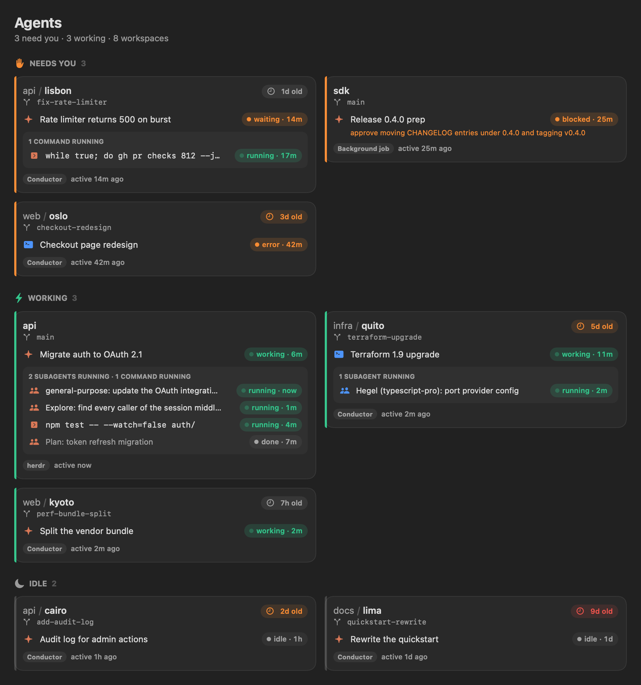
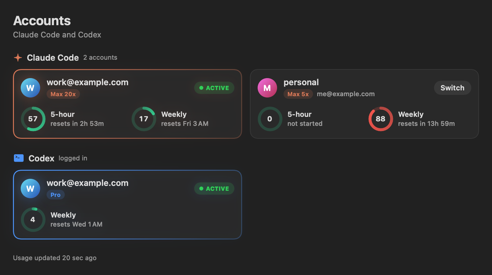

# AgentBar

A macOS app for keeping track of your coding agents. It shows what every
Claude Code and Codex agent on your Mac is doing, across Conductor, herdr and
plain terminals, runs features that span several repos, and lets you switch
between Claude Code accounts.



## Features

### Agents

Every open workspace and running agent, grouped by what needs you:

- **Needs you**: agents asking for input, a permission or a plan review,
  blocked, or stopped on an error, with how long they've been waiting. Blocked
  background jobs say what they need.
- **Idle**: finished, waiting on your next step.
- **Working**, including agents whose turn is over but whose subagents or
  commands are still running ("background tasks").
- **Stale**: nothing for 3+ days; collapsed.
- **Last message** from each agent on its card, so you can see what it's asking
  or where it stopped without switching to it.
- **Workspace age** on every card: amber after 2 days, red after 7.
- **Subagents** (Claude Code and Codex) and **running commands**, such as a test
  run or a polling loop, with how long each has been going.
- **Workspace page**: click a card for a page with an activity graph of the
  workspace, its agents and everything each one started (subagents, nested
  subagents, commands), linked to the agent that started it and animated while
  running. Below it: every agent's full last message, every subagent and
  command, and the workspace's details. The back button returns to all agents.
- **Open in Conductor or herdr**: opens that Conductor workspace and chat, or
  focuses that herdr pane, bringing Conductor or the terminal forward on
  whichever display or Space it's on. Right-click a card to reveal the folder
  or copy its path.
- **Notifications** when an agent starts needing you, with its last message.
  Clicking one jumps to that agent.

Refreshes every 5 seconds.

### Features (multi-repo)

- **Workspaces**: a set of repos you pick, by their main clones. Add and
  remove repos at any time.
- **Lead agent**: starting a feature starts a Claude Code agent that reads
  every repo at `origin/main` and can't change files. It works out the feature
  with you, uses SageOx's read commands (`ox query`, `ox code search`,
  `ox conversation`) per repo, writes a plan, and asks which one repo should
  keep it.
- **One agent per repo**: once you approve, the lead starts an agent in each
  repo it needs, in a worktree on a branch named after the feature. Each
  agent follows its own repo's CLAUDE.md and SageOx setup.
- **One lane per repo**: the lead's card and each repo's card, with status,
  subagents, commands, last message, uncommitted files and commits ahead.
  Clicking a card focuses that agent in herdr.

Needs herdr. Agents run in a herdr workspace per feature, one tab per repo.

### Accounts



- **One-click switching** between Claude Code accounts. New `claude` sessions
  use the account you switch to.
- **Usage** for each account: 5-hour and weekly limits, with time until reset.
- **Codex usage** for the account logged in to the Codex CLI.
- **No extra logins**: reuses the logins Claude Code and Codex already saved.

### Menu bar

A single menu bar icon that brings up the AgentBar window.

### Themes

Settings (⌘,) has five color themes: Aurora, Ember, Ocean, Classic and Mono.

## Install

Requires macOS 14 or later and the Xcode Command Line Tools
(`xcode-select --install`). No other dependencies.

```sh
git clone https://github.com/shrimalmadhur/agentbar.git
cd agentbar
./build.sh
open build/AgentBar.app
```

To start it at login, add `build/AgentBar.app` under System Settings → General →
Login Items.

## Saving Claude Code accounts

1. Log in to Claude Code with your first account (`claude`, then `/login`).
2. On the Accounts page, click **Save Current Login**.
3. Log in with your next account and save it the same way.
4. Click any account to switch to it.

Claude Code sessions that are already running keep their account; start a new
session to use the one you switched to.

## How it works

AgentBar only reads what the tools already write to disk. The exceptions are
switching accounts, which writes Claude Code's login in the Keychain, and
starting features, which creates worktrees and herdr workspaces.

### Agents page

| What | Where it comes from |
| --- | --- |
| Conductor workspaces and agent status | Conductor's database, `~/Library/Application Support/com.conductor.app/conductor.db`, opened read-only |
| herdr agents | `herdr agent list` |
| Claude Code in other terminals | `~/.claude/sessions/<pid>.json`, kept up to date by every Claude Code process |
| Claude Code background jobs | `~/.claude/jobs/<id>/state.json` |
| Claude Code subagents | `~/.claude/projects/<folder>/<session>/subagents/` |
| Codex subagents | the `threads` table in `~/.codex/state_5.sqlite` |
| Running commands | shell processes started by a `claude` or `codex` process |
| Last message | Conductor's `session_messages` table, or the end of the Claude Code transcript |
| Branch and worktree age | the workspace's `.git` |

A subagent counts as running if it wrote to its transcript (Claude Code) or
thread (Codex) in the last minute. Finished ones stay listed for 10 minutes.

Clicking a Conductor card opens `conductor://workspace?id=<workspace>&session=<chat>`.
That link isn't in Conductor's docs; it's handled by the Conductor app itself.

### Features page

`agentbar-feature` (bundled in the app) does the work, and its header lists
the folders under `~/agentbar/<workspace>/`.

- `agentbar-feature lead <workspace> <feature>` fetches each repo, moves its
  read-only checkout in `main/` to `origin/main`, and starts the lead in a new
  herdr workspace. The lead runs with Edit, Write and NotebookEdit disabled;
  Read, Grep, Glob and a short list of `git` and `ox` read commands run without
  asking, and anything else asks you first.
- `agentbar-feature delegate <repo>` is what the lead runs to start a repo's
  agent, so you approve each one. It adds a worktree of that repo on the
  feature's branch and starts `claude` with the task in a new herdr tab.

Claude Code asks whether to trust each new folder. Trust `~/agentbar` once
(run `claude` there and accept) and it covers every lead and repo agent.

### Accounts page

Claude Code keeps its login in the macOS Keychain (service
`Claude Code-credentials`). AgentBar saves a copy of each account's login in
the Keychain under the service `cc-auth`, and switching writes the chosen copy
back.

- Only the `claudeAiOauth` login is swapped. MCP server tokens stored in the
  same Keychain item are left as they are.
- Claude Code renews its login while it runs, which invalidates older saved
  copies. Before every refresh and switch, AgentBar copies the active login
  back into its account's slot, so saved copies stay current.
- Switching is refused if the active login isn't saved in any slot, so it can't
  be overwritten and lost.
- AgentBar never renews the active login itself; running sessions hold it.
  Inactive accounts are renewed when their token expires.
- Keychain access goes through `/usr/bin/security`, which already has access to
  Claude Code's item, so macOS doesn't ask for your password.

The storage layout matches [cc-auth](https://github.com/rsnodgrass/claude-code-auth)
by Ryan Snodgrass, which inspired this page. Accounts saved with cc-auth appear
in AgentBar without logging in again, and the two can be used side by side.

Usage comes from `https://api.anthropic.com/api/oauth/usage` (Claude Code) and
`https://chatgpt.com/backend-api/wham/usage` (Codex). Both answer HTTP 429 when
called often, so AgentBar saves each response to disk (for Claude accounts, in
cc-auth's `usage.json` for the slot) and only asks again once it's 10 minutes
old, waiting longer if the server says to. The Refresh button asks right away. The Codex login is read
from `~/.codex/auth.json` and never renewed by AgentBar.

## Caveats

- Unofficial and not affiliated with Anthropic, OpenAI, Conductor or herdr.
- Almost everything above is an undocumented internal of those tools and may
  change without notice. Each source is read separately, so if one breaks, the
  rest keep working and the Agents page says which one failed.
- Codex sessions outside Conductor and herdr aren't shown (Codex writes no live
  status file for them).
- macOS only.

## License

[MIT](LICENSE)
